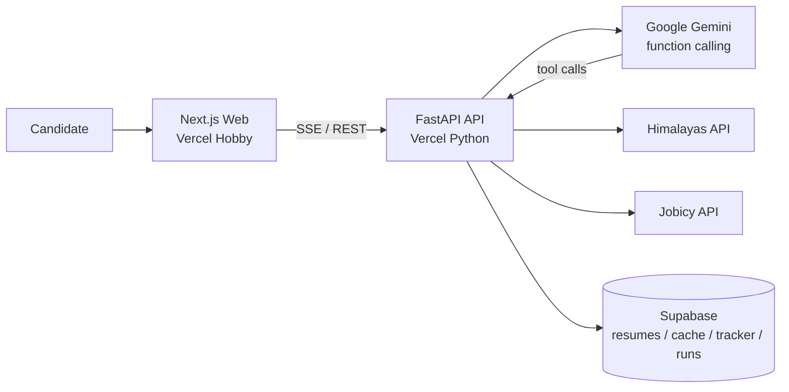

# Job Hunt Agent

[](https://github.com/drin-tech-tools/job-hunt-agent/actions/workflows/ci.yml)
[](apps/api)
[](apps/web)
[](DEPLOYMENT.md)

> Portfolio project #2 for an aspiring AI Engineer — an inspectable **AI job-hunt agent** that searches remote boards, scores resume fit, drafts cover letters, and tracks applications.

**Pitch:** Paste a resume, run the agent, watch a live tool-call trace (SSE), and apply via the original Himalayas / Jobicy URLs. Built as a public monorepo that deploys as **two free Vercel Hobby projects** (API + Web) on free-tier Gemini + Supabase.

## Architecture



## Tech stack

| Layer | Choice |
| --- | --- |
| Agent | `google-genai` Python SDK, native function calling, model fallback |
| API | FastAPI · Python 3.12 · httpx · Pydantic v2 · SSE |
| Web | Next.js App Router · TypeScript · Tailwind |
| Data | Supabase Postgres (`sb_secret_` service key) |
| Job boards | [Himalayas](https://himalayas.app/jobs/api) + [Jobicy](https://jobicy.com/api/v2/remote-jobs) (attribution required) |
| Deploy | Two Vercel Hobby projects from one public repo |
| CI | GitHub Actions: ruff + pytest · tsc + next build |

## Engineering decisions

- **Two Vercel projects, one repo** — Hobby cannot host mixed Python + Next runtimes cleanly in one project; Root Directory `apps/api` and `apps/web` keeps free-tier limits honest.
- **Model fallback chain** — `GEMINI_CHAT_MODEL` or `[gemini-3.5-flash-lite → gemini-3.1-flash-lite → gemini-flash-latest → gemini-3.8-flash]`; skip 2.5 models that 404 for new keys; low/no thinking when supported.
- **Guardrails** — max 8 steps, per-tool timeouts + retries/backoff, overall run timeout, persisted step traces.
- **Attribution** — every job includes `source` (`Himalayas` / `Jobicy`) and original `apply_url` (board terms). Optional `JSEARCH_API_KEY` stub stays off when unset.
- **Cache** — search results stored in Supabase `jobs_cache` with TTL to stay within free board/API budgets.
- **Heuristic offline path** — without `GEMINI_API_KEY`, the API still runs tools end-to-end so local demos and CI stay green.

## Repo structure

```
apps/api/          FastAPI + Vercel Python entrypoint
apps/web/          Next.js App Router UI
supabase/migrations/  SQL schema
evals/             Synthetic resume/posting pairs + consistency script
.github/workflows/ CI
DEPLOYMENT.md      Free-tier deploy guide
```

## Local development

### API

```bash
cd apps/api
cp .env.example .env   # optional for local memory mode
uv sync --group dev
uv run uvicorn app.main:app --reload --port 8000
uv run pytest -q
uv run ruff check .
```

### Web

```bash
cd apps/web
cp .env.example .env.local
# NEXT_PUBLIC_API_URL=http://localhost:8000
npm install
npm run dev
npm run typecheck && npm run build
```

### Evals

```bash
cd apps/api && uv sync --group dev
uv run python ../../evals/measure_consistency.py
```

## Deploy

See **[DEPLOYMENT.md](DEPLOYMENT.md)** — Supabase migration, Gemini key, two Vercel projects, CORS/`NEXT_PUBLIC_API_URL` wiring. The GitHub repo must be **public** for Hobby org deploys from a connected repo.

## License

MIT — job board content remains subject to Himalayas / Jobicy terms; this project only links to original apply URLs.
