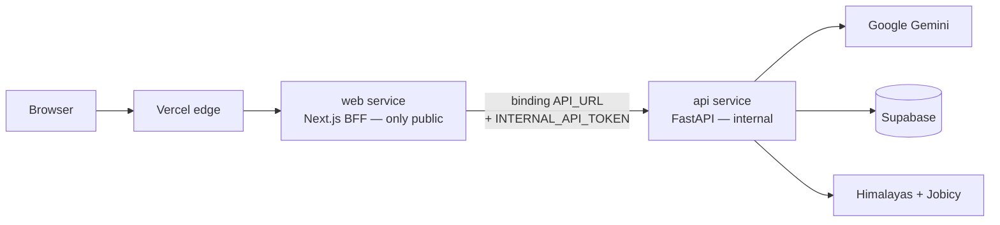
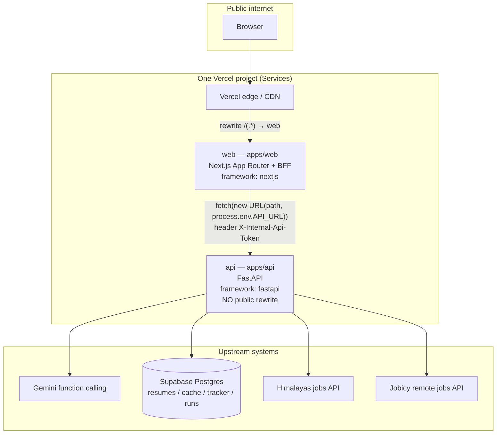

# Job Hunt Agent

[](https://github.com/drin-tech-tools/job-hunt-agent/actions/workflows/ci.yml)
[](docs/TESTING.md)
[](apps/api)
[](apps/web)
[](DEPLOYMENT.md)

> Portfolio project #2 for an aspiring AI Engineer — an inspectable **AI job-hunt agent** that searches remote boards, scores resume fit, drafts cover letters, and tracks applications.

**Pitch:** Paste a resume, run the agent, watch a live tool-call trace (SSE), and apply via the original Himalayas / Jobicy URLs. Built as a public monorepo that deploys as **one Vercel project** (Next.js BFF + internal FastAPI) on free-tier Gemini + Supabase.

## Architecture (at a glance)



## Backend Architecture

This section is the client-facing map of how the backend is structured, secured, and run — locally and on Vercel Services.

### Why BFF (engineering decision)

The UI must not hold Gemini or Supabase secrets, and FastAPI must not be a public attack surface. A **Backend-for-Frontend** on the Next.js `web` service:

- Keeps one public origin (cookies, CORS, and Deployment Protection stay simple).
- Gives the browser same-origin `/api/*` routes while FastAPI stays **internal** (no top-level rewrite targets `api`).
- Uses a Vercel **service binding** so `API_URL` is deployment-aware (preview `web` always hits that preview’s `api`) and never hardcoded.
- Lets us allowlist and zod-validate only the endpoints the UI needs, then optionally authenticate upstream with `INTERNAL_API_TOKEN`.

Bindings resolve at **function runtime only** (not during `next build`, not in middleware). All BFF code lives in Route Handlers under `apps/web/app/api/`.

### Deployment topology



Only `web` is public. `api` is reachable solely through the binding (and locally on `:8000` for non-Vercel fallback / pytest).

### Agent run sequence (SSE)

```mermaid
sequenceDiagram
  autonumber
  actor User
  participant Web as web BFF<br/>/api/agent/run
  participant API as api FastAPI<br/>/agent/run
  participant Loop as AgentRunner
  participant Tools as Tools<br/>search_jobs / fetch_posting<br/>score_fit / draft_cover_letter<br/>save_to_tracker
  participant Ext as Gemini / boards / Supabase

  User->>Web: POST role + resume (same-origin)
  Web->>Web: zod validate agentRunSchema
  Web->>API: POST /agent/run<br/>API_URL + X-Internal-Api-Token
  API-->>Web: text/event-stream
  Web-->>User: stream through (no buffer; abort upstream on disconnect)

  API->>Loop: run_events(AgentRunRequest)
  Loop-->>User: SSE event run_started
  loop Up to AGENT_MAX_STEPS
    Loop->>Ext: Gemini plan (function calling)
    Ext-->>Loop: tool name + args
    Loop->>Tools: execute_tool (timeout + retries)
    Tools->>Ext: boards / heuristics / Supabase
    Ext-->>Tools: result
    Tools-->>Loop: result + summary + ms
    Loop-->>User: SSE event step (trace)
  end
  Loop-->>User: SSE event final (jobs + message)
```

### `vercel.json` (services, rewrite, binding)

Root config — build/runtime keys live **inside** each service (not top-level):

```json
{
  "$schema": "https://openapi.vercel.sh/vercel.json",
  "services": {
    "api": {
      "root": "apps/api",
      "framework": "fastapi",
      "functions": { "app/main.py": { "maxDuration": 300 } }
    },
    "web": {
      "root": "apps/web",
      "framework": "nextjs",
      "bindings": [
        {
          "type": "service",
          "service": "api",
          "format": "url",
          "env": "API_URL"
        }
      ],
      "functions": {
        "app/api/agent/run/route.ts": { "maxDuration": 300 }
      }
    }
  },
  "rewrites": [
    { "source": "/(.*)", "destination": { "service": "web" } }
  ]
}
```

| Piece | Meaning |
| --- | --- |
| `services.api` | FastAPI at `apps/api` (`app/main.py` entry). Internal by default. |
| `services.web` | Next.js at `apps/web`. Declares the binding that injects `API_URL`. |
| `bindings` | Network grant + URL injection. **Do not** set `API_URL` in the Vercel dashboard. |
| `rewrites` | Single public catch-all → `web`. No rewrite targets `api`. |
| `maxDuration` | Sized for SSE agent runs (`AGENT_OVERALL_TIMEOUT_S` ≈ 90s plus overhead). |

### Backend module layout

```
apps/api/
├── api/index.py              # Legacy ASGI re-export (optional; framework uses app/main.py)
├── app/
│   ├── main.py               # FastAPI app, CORS (local-only), INTERNAL_API_TOKEN middleware
│   ├── config.py             # pydantic-settings: Gemini, Supabase, guardrails, mock flag
│   ├── models/schemas.py     # Request/response + tool I/O (Pydantic v2)
│   ├── routes/
│   │   ├── health.py         # GET /health
│   │   ├── resumes.py        # Resume CRUD
│   │   ├── tracker.py        # Application tracker CRUD
│   │   └── agent.py          # POST /agent/run → SSE (sse-starlette)
│   ├── agent/
│   │   ├── loop.py           # Gemini function-calling loop + step traces
│   │   ├── mock_runner.py    # AGENT_MOCK=1 scripted tools (Cucumber / demos)
│   │   └── fixtures.py       # Deterministic fixture jobs
│   ├── tools/
│   │   ├── registry.py       # Tool declarations + dispatch + retries/timeouts
│   │   ├── jobs.py           # Himalayas / Jobicy / optional JSearch + cache
│   │   └── scoring.py        # score_fit + draft_cover_letter heuristics
│   └── services/
│       └── supabase_client.py  # Repository: resumes, tracker, jobs_cache, runs
│                               # (in-memory fallback when Supabase unset)
├── tests/                    # pytest (unit + TestClient)
└── pyproject.toml

apps/web/
├── app/api/                  # BFF Route Handlers (allowlisted proxy)
│   ├── health/route.ts
│   ├── resumes/route.ts
│   ├── resumes/[id]/route.ts
│   ├── tracker/route.ts
│   ├── tracker/[id]/route.ts
│   └── agent/run/route.ts    # SSE passthrough, runtime nodejs, maxDuration 300
├── lib/
│   ├── api.ts                # Browser client → same-origin /api/*
│   └── bff/
│       ├── api-base.ts       # getApiUrl() + internal token headers
│       ├── proxy.ts          # JSON proxy helper
│       └── schemas.ts        # zod validators
└── app/{page,agent,resume,tracker}/  # UI
```

**BFF route choice:** Next.js owns `/api/*` because FastAPI is no longer public. Each handler maps 1:1 onto FastAPI (`/api/health` → `/health`, `/api/agent/run` → `/agent/run`, …). Only the endpoints the UI uses are implemented (isolation).

### Security & isolation

| Control | How |
| --- | --- |
| Public surface | Top-level rewrite → `web` only |
| Internal API | No rewrite to `api`; reachability via binding only |
| Allowlisted BFF | Explicit Route Handlers; no generic reverse proxy |
| Input validation | zod on mutating BFF bodies; Pydantic on FastAPI |
| Shared secret | Optional `INTERNAL_API_TOKEN` → `X-Internal-Api-Token` |
| Secrets | `GEMINI_API_KEY`, Supabase secret, token are server-side only — never `NEXT_PUBLIC_*` |
| CORS | Not required in prod (browser never calls FastAPI). Kept harmless for local `:8000` /docs |

### Reliability & product guardrails

- **Step cap** — `AGENT_MAX_STEPS` (default 8) stops runaway tool loops.
- **Timeouts** — per-tool `TOOL_TIMEOUT_S`, overall `AGENT_OVERALL_TIMEOUT_S`, BFF/API `maxDuration`.
- **Retries** — tool dispatch uses exponential backoff (`TOOL_MAX_RETRIES`).
- **Model fallback** — `GEMINI_CHAT_MODEL` or ordered lite/latest chain; skip often-404 2.5 models.
- **Caching** — search results in Supabase `jobs_cache` with TTL to respect free board budgets.
- **Attribution** — every job keeps `source` (`Himalayas` / `Jobicy`) and original `apply_url`.
- **Mock mode** — `AGENT_MOCK=1` runs fixture tools so CI/E2E never need Gemini or live boards.
- **SSE hygiene** — BFF uses `runtime = "nodejs"`, streams the upstream body, sets `Cache-Control: no-cache` / `X-Accel-Buffering: no`, and aborts upstream when the client disconnects.

### Local setup vs production

| | Local | Production (Vercel Services) |
| --- | --- | --- |
| Preferred runner | `vercel dev` / `vercel dev -L` (injects binding) | Git-connected project from repo root |
| Fallback | `uvicorn :8000` + `next dev` with `API_URL=http://127.0.0.1:8000` | N/A — binding provides `API_URL` |
| Browser calls | Same-origin `/api/*` on `:3000` | Same-origin `/api/*` on the deployment URL |
| Data / LLM | Memory store + heuristic or `AGENT_MOCK` | Supabase + Gemini |
| Docs | FastAPI `/docs` on `:8000` | `/docs` internal only (fine) |

See **[DEPLOYMENT.md](DEPLOYMENT.md)** for env vars and import steps.

## Tech stack

| Layer | Choice |
| --- | --- |
| Agent | `google-genai` Python SDK, native function calling, model fallback |
| API | FastAPI · Python 3.12 · httpx · Pydantic v2 · SSE |
| BFF / Web | Next.js App Router · TypeScript · zod · Tailwind |
| Data | Supabase Postgres (`sb_secret_` service key) |
| Job boards | [Himalayas](https://himalayas.app/jobs/api) + [Jobicy](https://jobicy.com/api/v2/remote-jobs) (attribution required) |
| Deploy | One Vercel project · Services (`web` public, `api` internal) |
| CI | GitHub Actions: ruff + pytest · tsc + next build · Cucumber E2E (mock) |
| Acceptance | Cucumber.js + Playwright (`tests/e2e`) with `AGENT_MOCK=1` |

## Engineering decisions

- **One Vercel project, BFF pattern** — Services keep Python + Next in sync (skew protection, shared previews) while FastAPI stays off the public internet.
- **Model fallback chain** — `GEMINI_CHAT_MODEL` or `[gemini-3.5-flash-lite → gemini-3.1-flash-lite → gemini-flash-latest → gemini-3.8-flash]`; skip 2.5 models that 404 for new keys; low/no thinking when supported.
- **Guardrails** — max 8 steps, per-tool timeouts + retries/backoff, overall run timeout, persisted step traces.
- **Attribution** — every job includes `source` (`Himalayas` / `Jobicy`) and original `apply_url` (board terms). Optional `JSEARCH_API_KEY` stub stays off when unset.
- **Cache** — search results stored in Supabase `jobs_cache` with TTL to stay within free board/API budgets.
- **Heuristic offline path** — without `GEMINI_API_KEY`, the API still runs tools end-to-end so local demos and CI stay green.

## Repo structure

```
apps/api/          FastAPI (internal service)
apps/web/          Next.js App Router UI + /api BFF
tests/e2e/         Cucumber.js + Playwright acceptance suite
docs/TESTING.md    BDD/TDD workflow + test pyramid
supabase/migrations/  SQL schema
evals/             Synthetic resume/posting pairs + consistency script
.github/workflows/ CI
vercel.json        Vercel Services definition
DEPLOYMENT.md      Single-project deploy guide
```

## Local development

### API

```bash
cd apps/api
cp .env.example .env   # optional for local memory mode
uv sync --group dev
uv run uvicorn app.main:app --reload --port 8000
uv run pytest -q
uv run ruff check .
```

### Web

```bash
cd apps/web
cp .env.example .env.local
# API_URL=http://127.0.0.1:8000   # server-only; used by BFF Route Handlers
npm install
npm run dev
npm run typecheck && npm run build
```

### Both with bindings

```bash
# from repo root
vercel dev
# or: vercel dev -L
```

### Evals

```bash
cd apps/api && uv sync --group dev
uv run python ../../evals/measure_consistency.py
```

## Testing (BDD/TDD)

Acceptance tests are **Cucumber.js + Playwright** (Gherkin journeys). Pytest remains the unit/API layer of the pyramid. By default E2E runs with **`AGENT_MOCK=1`** so Gemini and live job boards are never required. The orchestrator sets `API_URL` on the Next.js process so journeys go **Browser → BFF → FastAPI**.

```bash
# Unit + API
cd apps/api && uv sync --group dev && uv run pytest -q

# Web
cd apps/web && npm ci && npm run typecheck && npm run build

# Full acceptance (starts API + web in mock mode, then Cucumber)
cd tests/e2e && npm ci
cd ../.. && npm run test:e2e
```

See **[docs/TESTING.md](docs/TESTING.md)** for red-green-refactor, tags (`@smoke`, `@agent`, `@tracker`, `@live`), and HTML/JSON reports under `tests/e2e/reports/`.

## Deploy

See **[DEPLOYMENT.md](DEPLOYMENT.md)** — Supabase migration, Gemini key, single Vercel Services project, optional `INTERNAL_API_TOKEN`. The GitHub repo must be **public** for Hobby org deploys from a connected repo.

## License

MIT — job board content remains subject to Himalayas / Jobicy terms; this project only links to original apply URLs.
